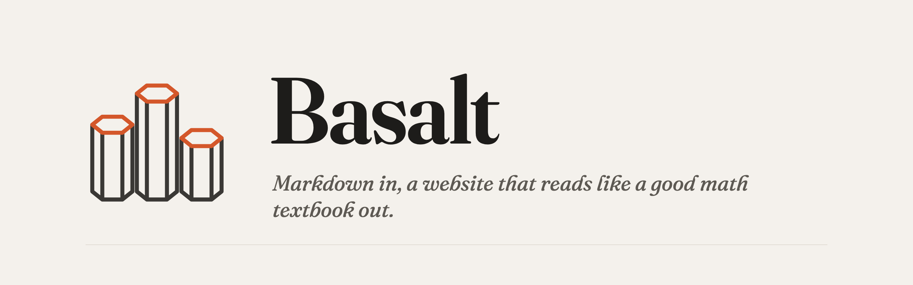

**TL;DR:** Basalt turns markdown into a website that reads like a good math textbook. Think [Quartz](https://quartz.jzhao.xyz), with remarks in the margin, better media, and hot reloading that keeps your place.

It's set the way [Edward Tufte](https://www.edwardtufte.com/) sets his books, with each remark beside the line it's about. See it at [basalt.isaacchacko.com](https://basalt.isaacchacko.com), which is built with it.

## What's different

- **Remarks in the margin:** sidenotes, margin notes and previews of linked notes, each beside its line
- **One viewer for every picture:** images, diagrams and pages open full screen, to zoom, pan and swipe through
- **Its own PDF reader,** with selectable text and the browser's viewer a click away
- **Pictures written as text:** graphs, flowcharts, sequences and math
- **Live components** in a still page, swapped in as you edit them
- **Saves that land in place,** in under a second, keeping your scroll
- **Built for agents:** the dev server says when a change is live, and what broke
- **Light pages,** about a quarter of Quartz's weight

## Start

```sh
git clone https://github.com/isaacchacko/basalt && cd basalt
npm install
node bin/basalt.mjs new ../my-garden --title "My garden"
node bin/basalt.mjs dev ../my-garden      # http://localhost:4321
```

Your notes go in `my-garden/notes/`. [BASALT.md](BASALT.md) covers the site's files, the CLI, what you can write, and the edit loop for agents.

## Made from

[Astro](https://astro.build), with markdown from [Quartz](https://quartz.jzhao.xyz)'s plugins and margins after [Tufte CSS](https://edwardtufte.github.io/tufte-css/). Set in [Fraunces](https://fonts.google.com/specimen/Fraunces) and [Instrument Sans](https://fonts.google.com/specimen/Instrument+Sans). Graphs by [graph](https://graph.isaacchacko.com), PDFs by [pdf.js](https://mozilla.github.io/pdf.js/), math by [KaTeX](https://katex.org). MIT licensed.
