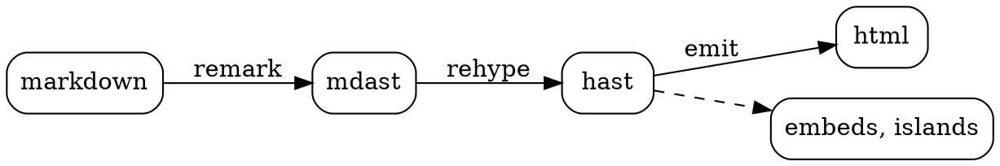
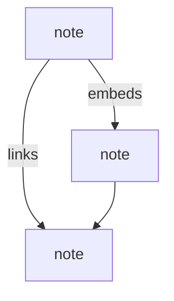

Pictures written as text.

## graph

A ` ```graph ` block in [graph](https://graph.isaacchacko.com)'s language, drawn by its renderer: drag the nodes, scroll to zoom. It's laid out at build time too, so with no JavaScript it's an svg of the same layout.

```graph title="what basalt is made of"
basalt {tomato 2} -> quartz, graph
quartz -> remark, rehype, preact
graph -> renderer, website
renderer -> physics, camera, labels
basalt -> embeds, islands, diagrams
diagrams -> renderer, graphviz, katex
```

## graphviz

Drawn at build time, so it's in the html: no script, works in popovers and feeds. Its ink is `currentColor`, so it follows dark mode.



## mermaid

Drawn in the browser by Quartz; until then the source shows.



## math

Inline $e^{i\pi} + 1 = 0$, a `$$` block, and a GitHub-style ` ```math ` block, which Quartz showed as code:

$$
\int_0^\infty e^{-x^2}\,dx = \frac{\sqrt{\pi}}{2}
$$

```math
\sum_{n=1}^{\infty} \frac{1}{n^2} = \frac{\pi^2}{6}
```

## svg

```svg
<svg viewBox="0 0 120 40" width="240" xmlns="http://www.w3.org/2000/svg">
  <rect x="2" y="2" width="116" height="36" rx="8" fill="none" stroke="currentColor"/>
  <text x="60" y="26" text-anchor="middle" font-size="16" fill="currentColor">inline svg</text>
</svg>
```

## a diagram that doesn't parse

It fails the figure, not the build:

```dot
digraph { a -> }
```
