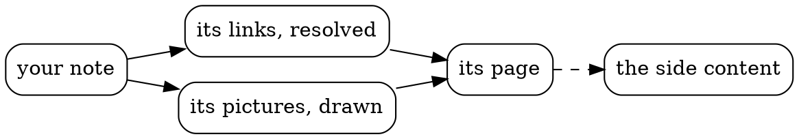
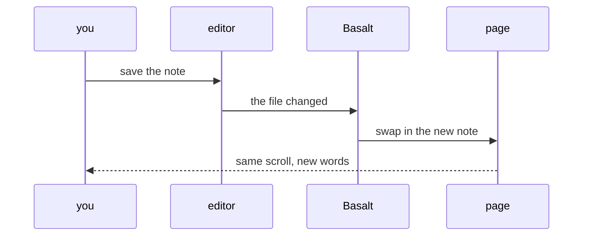

Some pictures are easier to write than to draw. Write one in a code block, and Basalt draws it. Each stays as text in your note, so you can change it as easily as a sentence.

## A graph

A ` ```graph ` block in [graph](https://graph.isaacchacko.com)'s language: one line per link, with `{colour size}` for a node. Drag the nodes and scroll to zoom. Basalt lays it out when the site is built, so without JavaScript it's still a picture of the same graph.

```graph title="what a garden is made of"
garden {tomato 2} -> notes, links, pictures
notes -> sidenotes, asides
links -> previews, backlinks
pictures -> diagrams, images, pdfs
diagrams -> graphs, flowcharts, math
```

## A flowchart

A ` ```dot ` block in [Graphviz](https://graphviz.org)'s language, drawn when the site is built. It's plain html in the page, with no script to wait for, and its ink follows the page into dark mode.



## A sequence

A ` ```mermaid ` block, drawn in the browser by [Mermaid](https://mermaid.js.org):



## Math

Inline, like $e^{i\pi} + 1 = 0$, or set on its own line with `$$`:

$$
\int_0^\infty e^{-x^2}\,dx = \frac{\sqrt{\pi}}{2}
$$

GitHub's ` ```math ` blocks work too:

```math
\sum_{n=1}^{\infty} \frac{1}{n^2} = \frac{\pi^2}{6}
```

## SVG

An ` ```svg ` block is drawn as it's written:

```svg
<svg viewBox="0 0 120 40" width="240" xmlns="http://www.w3.org/2000/svg">
  <rect x="2" y="2" width="116" height="36" rx="8" fill="none" stroke="currentColor"/>
  <text x="60" y="26" text-anchor="middle" font-size="16" fill="currentColor">drawn as text</text>
</svg>
```

Click any of these to see it full screen.

## A typo

A diagram that doesn't parse says so, and the rest of the page builds:

```dot
digraph { a -> }
```
