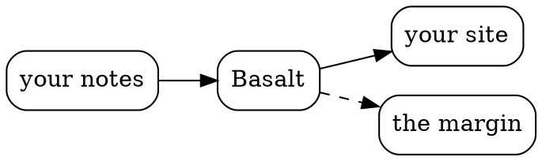

**TL;DR:** Basalt turns markdown into a website that reads like a good math textbook.[^this] Think Quartz, with remarks in the margin, better media, and hot reloading that keeps your place.

## After Tufte

Basalt is set the way [Edward Tufte](https://www.edwardtufte.com/) sets his books, and the way a good math textbook keeps its asides: beside the text, where the eye already is.

> [!aside]
> ![[tufte.jpg|Edward Tufte]]
> Edward Tufte, Dallas, 2015. Photo by Keegan Peterzell, [CC BY-SA 4.0](https://creativecommons.org/licenses/by-sa/4.0). Click it.

> [!aside] Why "Basalt"
> Basalt cools into hexagonal columns, like the Giant's Causeway, or this site's mark.

## What's different

**One margin.** Point at [[margin|this link]], and its page's opening appears beside it.

**Pictures written as text.** These three lines,

```txt
digraph { rankdir=LR; node [shape=box, style=rounded]
  "your notes" -> Basalt -> "your site"
  Basalt -> "the margin" [style=dashed] }
```

become this:



Math works too: $e^{i\pi} + 1 = 0$.

**Saves land in place.** The note below is saved, and the page changes under its reader, who keeps their place:

![[saving.mp4|a note saved, its page changing in place|gif]]

**Built for agents.** An agent saves, then waits for the page to have it:

```sh
$ basalt wait my-garden --after 12
{ "buildId": 13, "state": "ready", "change": "swap" }
```

**Light pages.** The [[margin]] page, beside the same page built by Quartz:

|               | Quartz | Basalt |
| ------------- | -----: | -----: |
| html          |  134KB |   35KB |
| first scripts |  188KB |   50KB |

The rest is on the tour: [[media]], [[web]], [[diagrams]], [[files]], [[islands]], [[transclusion]], [[start]] and [[agents]].

## Made from

[Astro](https://astro.build), with markdown from [Quartz](https://quartz.jzhao.xyz)'s plugins and margins after [Tufte CSS](https://edwardtufte.github.io/tufte-css/). Set in [Fraunces](https://fonts.google.com/specimen/Fraunces) and [Instrument Sans](https://fonts.google.com/specimen/Instrument+Sans). Graphs by [graph](https://graph.isaacchacko.com), PDFs by [pdf.js](https://mozilla.github.io/pdf.js/), math by [KaTeX](https://katex.org). Made by [Isaac Chacko](https://isaacchacko.com) for his own garden.

[^this]: Like this remark: beside its line, not at the foot of the page.
