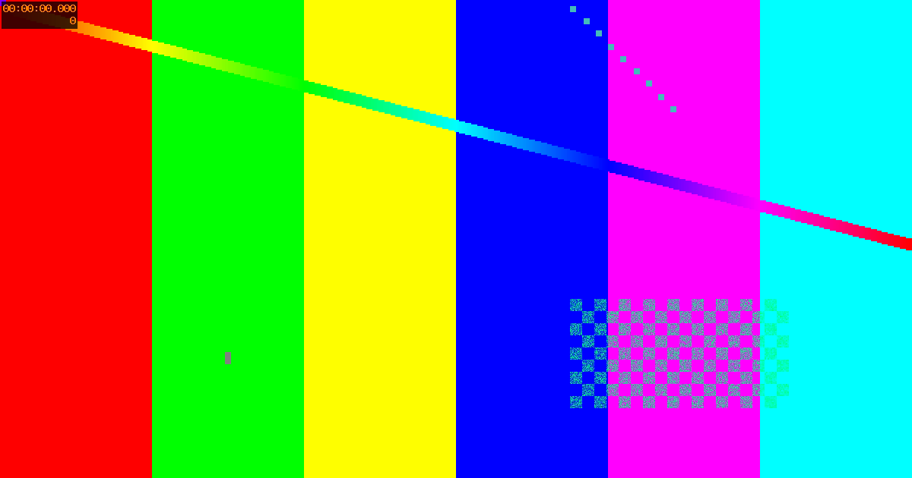

## images

A plain image, a sized one (`|320`), and one with a caption (the markdown title). Click any of them to see it full size.

![[card.png]]

![[card.png|320]]

## video

`![[clip.mp4]]`: a player that doesn't download the whole file until it's played.

![[clip.mp4]]

`![[clip.mp4|a looping clip|gif|480]]`: no controls, muted, looping, like a gif.

![[clip.mp4|a looping clip|gif|480]]

`![[clip.mp4#t=2|starts two seconds in]]`: media fragments pass through to the player.

![[clip.mp4#t=2|starts two seconds in]]

## audio

![[tone.m4a|a 440hz tone]]

## pdf

`![[basalt.pdf#page=2|560]]`: Basalt's own viewer, opened at page two, 560px tall. Its bar pages through, zooms, fits the width, goes full screen, opens the browser's viewer in a new tab, and downloads. With the viewer focused, the arrow keys page, + and - zoom, and F goes full screen.

![[basalt.pdf#page=2|560]]
