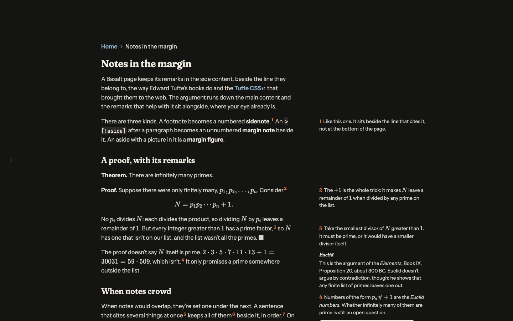

Put a file in your notes folder and embed it with `![[name]]`. Basalt works out what it is and gives it the right frame. Click any picture on this page and it grows out of the page to fill the screen. There you can zoom, pan, and step through every picture on the page with the arrow keys, or swipe on a phone.

## Pictures

A picture that's a remark, like this phone screenshot, goes in the side content: put it in an aside, `> [!aside]`, with its caption under it. A tall, narrow picture costs the text nothing there.

> [!aside]
> ![[phone.png]]
> The margin page on a phone, where its notes open under their lines.

A picture the text is about goes in the main content. A title in the markdown becomes its caption, ``, and `|320` after a name sets its width:

## Video

`![[saving.mp4]]` gets a player that doesn't fetch the file until you press play. This one is a page changing as its note is saved:

![[saving.mp4|saving a note, with the page open]]

Add `|gif` and it plays like one: muted, looping, no controls.

![[saving.mp4|the same, as a gif|gif|480]]

## Sound

`![[a440.m4a]]` gets a player in the page's own colours:

![[a440.m4a|A440, the note an orchestra tunes to]]

## Documents

`![[margin.pdf#page=2|560]]` opens a PDF in Basalt's own reader, at page two and 560 pixels tall. This one is the margin page of this tour, printed. Its bar turns pages, zooms, fits the width, goes full screen, opens the browser's own viewer at the page you're on, and downloads it. Its text can be selected and searched. With the reader focused, the arrow keys turn pages, + and − zoom, and F goes full screen.

![[margin.pdf#page=2|560]]
